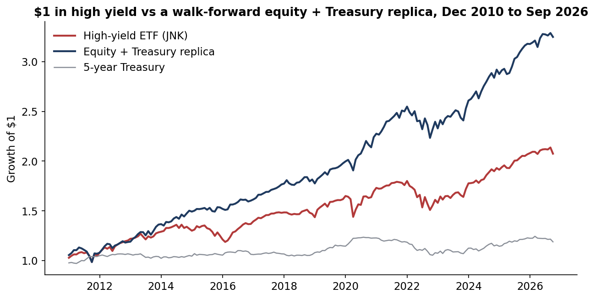
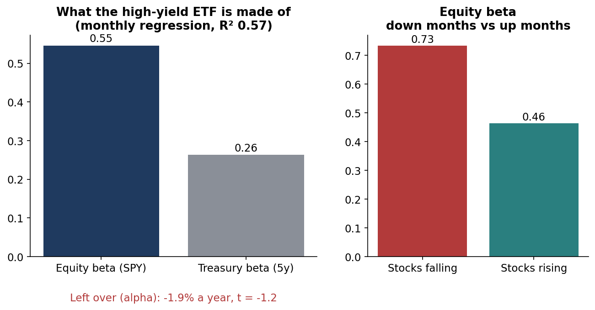
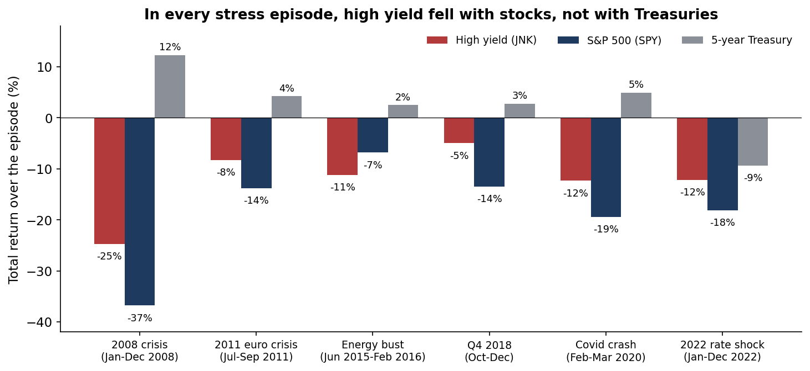
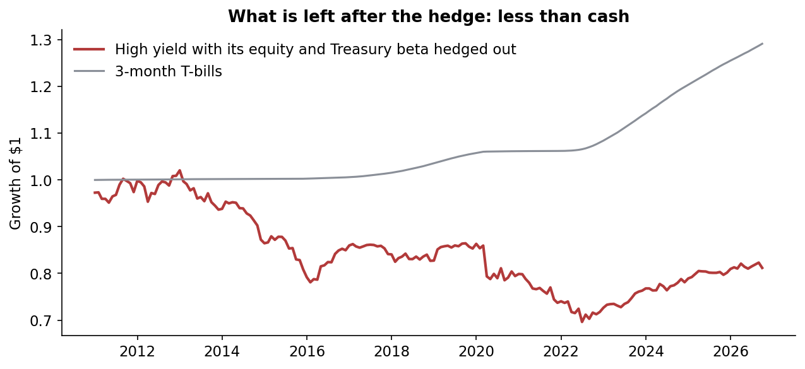
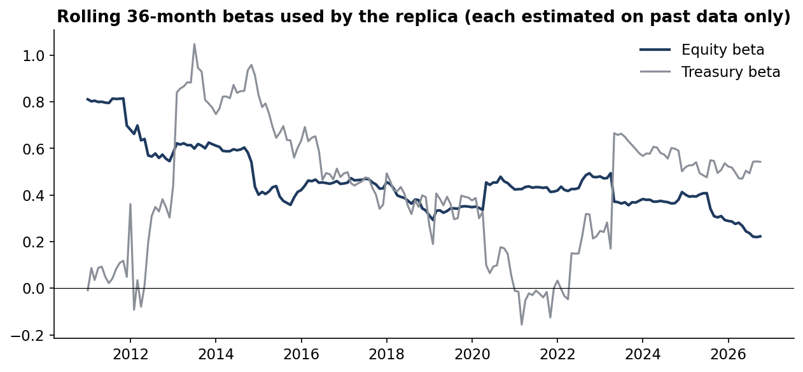

# Is high yield just expensive equity? A high-yield ETF against an equity + Treasury replica, 2007–2026

 

**Question.** Investors hold high-yield bonds for income and diversification. If a high-yield fund mostly behaves like a mix of stocks and Treasuries, what is left for the credit risk itself? Can a simple equity + Treasury portfolio, sized only on past data, do the same job?

**Answer, on real data.** The fund is the SPDR Bloomberg High Yield Bond ETF (JNK). It is measured with dividends, monthly, from December 2007 to September 2026.

- **About half of it is equity.** A monthly regression explains 57% of JNK's excess return with an equity beta of 0.55 (S&P 500, SPY) and a Treasury beta of 0.26 (5-year). What is left over is -1.9% a year (t = -1.2).
- **The equity beta is higher when it hurts.** In months when stocks fell, the equity beta was 0.73. When they rose, it was 0.46.
- **A replica did better.** A portfolio of SPY, a 5-year Treasury and cash used betas estimated on the prior 36 months only, with 5 bp trading costs. From 2010-12 to September 2026 it returned 7.7% a year against 4.7% for JNK, a gap of -3.0 points (t = -2.5).
  - It also had lower volatility (7.0% vs 7.7%) and a smaller worst drawdown (-13.0% vs -16.2%).
  - It was ahead in 11 of 16 years and in all three sub-periods.
- **After hedging, nothing was left.** With its equity and Treasury beta hedged out, JNK returned -1.3% a year. Cash returned 1.6%.
- **Stress episodes.** High yield fell with stocks in every episode tested, while the 5-year Treasury rose in all but 2022. In the 2015–16 energy bust, JNK lost 11% against 7% for SPY. That was the one genuinely credit-specific shock.

Full write-up: https://www.guptagaurav.info/articles/is-high-yield-just-expensive-equity

## Results

| Monthly, Dec 2007 – Sep 2026 | Annual return | Volatility | Worst drawdown |
|---|---|---|---|
| High-yield ETF (JNK) | 4.8% | 11.2% | -35.7% |
| S&P 500 (SPY) | 11.2% | 15.6% | -48.2% |
| 5-year Treasury (constant maturity) | 1.7% | 4.1% | -14.7% |
| 3-month T-bills | 1.5% | | |

| Walk-forward test, 2010-12 – Sep 2026 | Annual return | Volatility | Worst drawdown | Sharpe |
|---|---|---|---|---|
| High-yield ETF (JNK) | 4.7% | 7.7% | -16.2% | 0.40 |
| Equity + Treasury replica (net of 5 bp costs) | **7.7%** | 7.0% | -13.0% | **0.88** |
| JNK with equity and Treasury beta hedged out | -1.3% | 4.7% | | |

| Sub-period | JNK | Replica | JNK hedged |
|---|---|---|---|
| 2011-2015 | 3.4% | 7.6% | -4.0% |
| 2016-2020 | 7.4% | 8.4% | 0.2% |
| 2021-2026 | 3.2% | 6.4% | 0.3% |

The average replica weights were 0.46 in SPY and 0.42 in the 5-year Treasury, with the rest in cash and no leverage. Correlation with JNK was 0.81, and tracking error was 4.6% a year.







## Method

- **Returns.** Daily total returns for JNK and SPY include dividends and are compounded to months.
- **Treasury leg.** The 5-year Treasury return is a constant-maturity par bond built from the daily Treasury par curve: carry, minus modified duration × yield change, plus convexity. Cash is the 3-month bill.
- **Full-sample factor model.** Monthly excess returns over cash are regressed on SPY and Treasury excess returns, with Newey–West errors (6 lags). Up and down betas are split on the sign of SPY's excess return.
- **Replica.** Each month, the weights are the betas from the previous 36 months only. Holdings are cash + β_equity × (SPY − cash) + β_treasury × (Treasury − cash), less 5 bp per unit of weight change. A unit test confirms that changing the current month never changes its own betas.
- **Hedged fund.** JNK minus the same beta-weighted SPY and Treasury excess returns.
- **Significance.** The monthly return gap is tested with a Newey–West t-statistic (6 lags).

## The commercial case

The product is a **credit beta audit**: decompose any credit fund, ETF or manager into equity beta, rate beta and true credit return. Then show what a cheap, liquid replica would have earned.

| Element | Detail (illustrative where stated) |
|---|---|
| Who pays | OCIOs and consultants, pension and endowment allocators, insurers' general accounts, wealth platforms selecting credit funds |
| Problem in dollars | On this evidence, a $1bn high-yield allocation earned about $30M a year less than its equity + Treasury replica (illustrative; a past gap is not a forecast) |
| Product | A monthly credit beta report per holding: factor betas, up/down beta, walk-forward replica, hedged residual, stress episodes |
| Proof | This repository: real data, walk-forward, every number reproducible |
| Build | 4–6 weeks to run it across a client's credit line-up (one quant) |
| Pricing logic (illustrative) | $25–50k per line-up review, or $100k a year for a standing monitor |
| Adoption risks | Private credit funds report quarterly marks, so smoothing hides beta; replica turnover and the tax drag must be shown |

## Limits

- **One fund.** JNK is the only high-yield ETF with a long history in the source file. Results for HYG, active managers or the cash bond index may differ. Fund fees (about 0.40% a year) and ETF trading costs are inside JNK's return.
- **Treasury proxy.** The 5-year leg is a constant-maturity par bond built from yields, not a traded fund. A Treasury futures or ETF hedge would add small costs.
- **Strong equity decade.** 2011–2026 was strong for equities. The regression's negative alpha and the hedged result control for that, but a period of weak equities and good credit would narrow the gap.
- **Long-history evidence differs.** Long-history index research finds a positive credit risk premium after adjusting for term risk (Asvanunt and Richardson, 2017). This study is about one investable vehicle in one period.
- Independent research on public data. It is not investment advice and has not been deployed.

## Data and citations

Data
- JNK and SPY daily prices and dividends: Yahoo Finance, via [huggingface.co/datasets/defeatbeta/yahoo-finance-data](https://huggingface.co/datasets/defeatbeta/yahoo-finance-data) (ODC-BY).
- Daily US Treasury par yield curve: U.S. Department of the Treasury, via the same dataset.
- All three files are pinned by sha256 in `configs/default.yaml`.

Methods and related work
- Asvanunt, A. and Richardson, S. (2017). "The Credit Risk Premium." *Journal of Fixed Income* 26(3), 6–24. [lbsresearch.london.edu/id/eprint/567](https://lbsresearch.london.edu/id/eprint/567)
- Fama, E. F. and French, K. R. (1993). "Common Risk Factors in the Returns on Stocks and Bonds." *Journal of Financial Economics* 33(1), 3–56.
- Merton, R. C. (1974). "On the Pricing of Corporate Debt: The Risk Structure of Interest Rates." *Journal of Finance* 29(2), 449–470.
- Collin-Dufresne, P., Goldstein, R. S. and Martin, J. S. (2001). "The Determinants of Credit Spread Changes." *Journal of Finance* 56(6), 2177–2207.
- Newey, W. K. and West, K. D. (1987). "A Simple, Positive Semi-Definite, Heteroskedasticity and Autocorrelation Consistent Covariance Matrix." *Econometrica* 55(3), 703–708.

Code, analysis, charts and text were produced with AI assistance (Claude, by Anthropic) and reviewed by Gaurav Gupta.

## Run it

```bash
pip install -r requirements.txt
make all     # verifies the pinned files, runs the study (under a minute)
make test
```

Outputs: `reports/metrics.json`, `reports/yearly.csv`, `reports/betas.csv` and `reports/figures/`. Architecture: [docs/ARCHITECTURE.md](docs/ARCHITECTURE.md).

*Independent research on public data. Not investment advice. Dollar figures are illustrative.*
